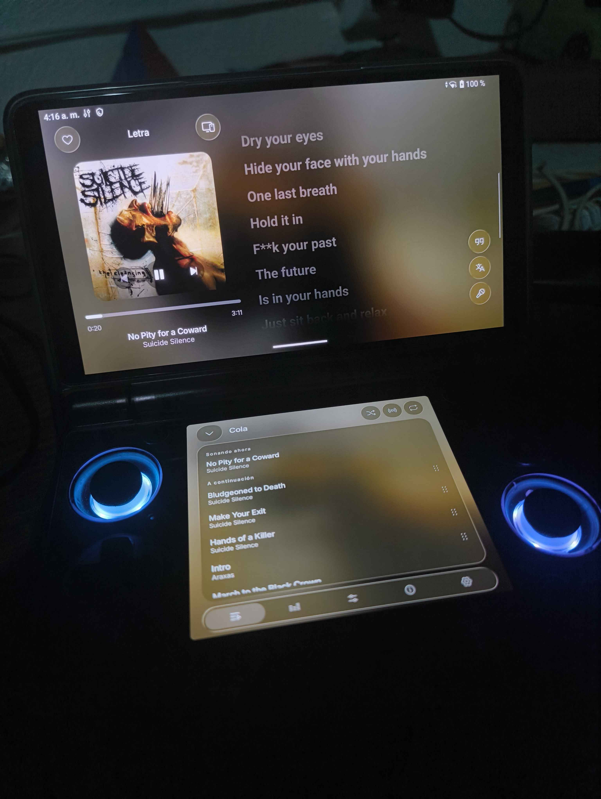
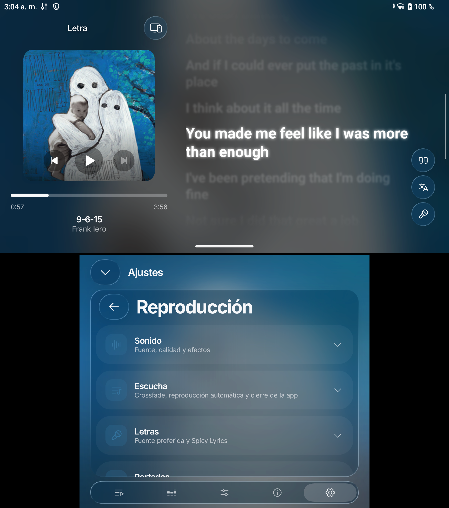
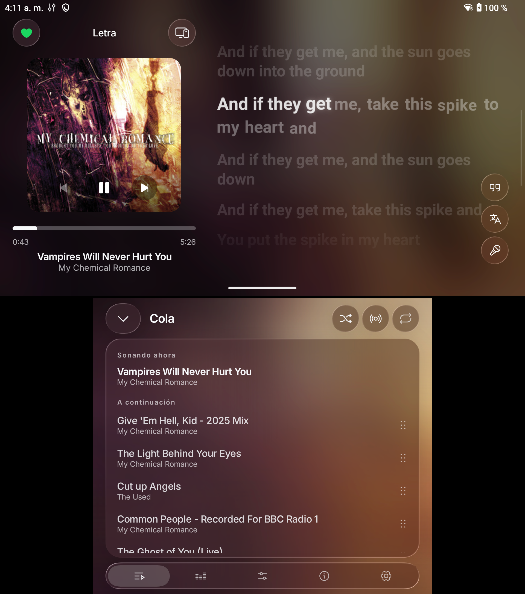
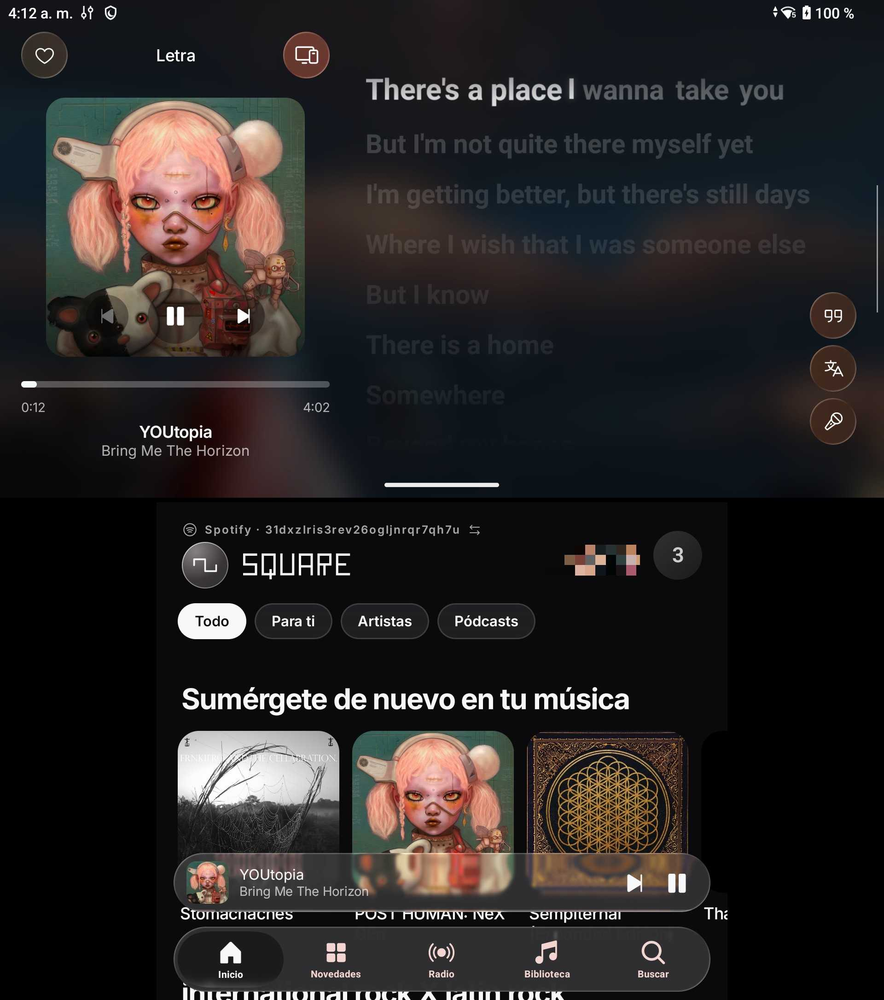

# Square — DS

**An unofficial fork of Square for dual-screen Android devices, tested on the AYN Thor.**

An unofficial YouTube Music / Spotify Premium client featuring a Liquid Glass interface, dedicated dual-screen playback, audio effects, Spotify Connect, listening history, and support for 8 languages. Powered by a Rust core built on librespot.

Based on [Square by Lelonio](https://github.com/Lelonio/Square).

[Download APK](https://github.com/srBenjamin1/Square/releases) · [Features](#features) · [Dual-screen mode](#dual-screen-mode) · [Installation](#installation) · [Original project](#original-project)

---

## About this fork

Square Dual Screen is a community-maintained adaptation of the original Square music player, designed to take advantage of Android devices with two independent displays.

Instead of duplicating the same interface on both screens, the application separates music playback from navigation and playback tools.

The project aims to preserve Square's original Liquid Glass design, music services, audio engine, and functionality while providing a more natural experience on dual-screen handhelds.

**Tested device:** AYN Thor, running its original Android firmware without root.

Compatibility with other dual-screen Android devices has not yet been verified. Display detection and behavior may vary depending on the device and firmware.

## Dual-screen mode

### Upper display — Dedicated music player

The upper screen provides a permanent, expanded music player.

Features include:

- Album artwork and playback controls.
- Track title, artist, duration, and progress.
- Synchronized lyrics with the original visual effects.
- Lyrics translation and available karaoke controls.
- Song favorites.
- Spotify Connect access.
- Dynamic colors and Liquid Glass effects.

The player remains expanded while browsing music on the lower display.

### Lower display — Navigation and playback tools

The lower screen provides Square's original navigation experience.

It includes:

- Home, New, Radio, Library, and Search.
- Albums, artists, and playlists.
- A persistent mini-player during normal navigation.
- An expandable playback tools panel.

The expanded panel provides access to:

- Playback queue.
- Shuffle and repeat controls.
- Song Radio.
- Equalizer.
- Audio effects.
- Track information.
- Playback settings.

Closing the tools panel restores the previous navigation view without interrupting playback.

### Touchscreen and controller support

Both screens retain their touchscreen functionality.

Controller-oriented navigation is under active development, including directional focus navigation, controller shortcuts, and contextual visual indicators inspired by handheld gaming interfaces.

The intended interaction model uses the D-Pad and left analog stick to navigate between interface elements, with a Liquid Glass focus indicator that disappears when switching to touch input.

Controller functionality may vary between releases. Check the release notes for features that have been implemented and tested.

---

## Screenshots

Square Dual Screen running on the AYN Thor.

| Dual-screen experience | Music player |
| :---: | :---: |
|  |  |

| Interface | Additional view |
| :---: | :---: |
|  |  |

## Features

The fork retains the features of the original Square project, including:

### Music services

**Spotify Premium**

- Personal playlists and library.
- Spotify Connect.
- Listening history.
- Music discovery and recommendations.
- Song credits and supported Spotify features.

**YouTube Music**

- Music catalogue and search.
- Optional Google account sign-in.
- Personal playlists and albums.
- Music videos and supported discovery features.

### Playback

- Dynamic album artwork and Canvas support.
- Synchronized lyrics.
- Song Radio and autoplay.
- Crossfade.
- Sleep timer.
- Playback queue.
- Shuffle and repeat.
- Background playback.

### Audio effects

- Equalizer.
- Playback speed and pitch.
- Reverb.
- Audio effect presets.
- Karaoke vocal reduction.
- Streaming quality settings.

### Library and offline listening

- Playlists, albums, artists, and liked songs.
- Search history.
- Local music files.
- Music downloads.
- Offline playback.
- Automatic downloads where supported.

### Interface

- Liquid Glass materials.
- Adjustable blur, refraction, and tint.
- Dynamic colors.
- Floating navigation elements.
- Eight languages: English, Italian, Spanish, French, German, Portuguese, Hindi, and Turkish.

The availability of individual features depends on the selected music service and the capabilities of the original Square implementation.

---

## Installation

### Requirements

- Android 8.0 or later, according to the original Square minimum requirement.
- An ARM64 Android device for the AYN Thor APK.
- Spotify Premium for Spotify playback.
- An internet connection for streaming and initial service configuration.

Dual-screen operation requires a compatible Android multi-display configuration.

### Download

Download the APK from:

**[Square Dual Screen — GitHub Releases](https://github.com/srBenjamin1/Square/releases)**

For AYN Thor, select the ARM64 APK when available.

Enable installation from the appropriate source in Android settings, then install the downloaded APK.

Development builds may be distributed as debug APKs. Android requires compatible signing certificates when updating an existing installation.

### Enable dual-screen mode

1. Install and open Square.
2. Complete the initial Spotify or YouTube Music setup.
3. Open Settings.
4. Enable the AYN Thor / dual-screen option.
5. Verify that the player appears on the upper display and navigation appears on the lower display.

The dual-screen option is intended to operate without root or privileged Android permissions.

---

## First launch

Square asks which music service you want to use.

**YouTube Music:** playback is available without signing in. Google account authentication is optional for personal library features.

**Spotify:** a Premium account is required. The original Square setup also requires registering a Spotify developer application and configuring its client ID.

Follow the setup instructions provided inside the application.

---

## Development status

This fork is under active development.

The dual-screen playback interface and lower-screen navigation have been implemented and tested on AYN Thor.

Further work includes controller navigation, focus indicators, interface refinements, and compatibility testing on additional dual-screen devices.

Features that have not been validated on physical hardware should not be considered fully supported.

Refer to each GitHub Release for the status of a particular build.

---

## Building from source

The project uses Kotlin, Jetpack Compose, Gradle, Rust, Librespot, and the Android NDK.

The current development environment uses:

- Java 21.
- Android SDK Platform 37.0.
- Android NDK 30.0.16248370.
- Rust with cargo-ndk.
- CMake.
- Gradle Wrapper.

To build a debug APK:

```bash
./gradlew :app:assembleDebug --no-configuration-cache
```

The ARM64 debug APK is generated at:

```text
app/build/outputs/apk/debug/app-arm64-v8a-debug.apk
```

Additional architecture, signing, and development instructions are available in [docs/DEVELOPMENT.md](docs/DEVELOPMENT.md).

---

## Original project

Square Dual Screen is an unofficial fork of:

**[Lelonio/Square](https://github.com/Lelonio/Square)**

The original application, its music integration, playback engine, Liquid Glass interface, and most of its functionality were developed by the original Square contributors.

This fork focuses on adapting that existing application for dual-screen Android hardware.

For the original single-screen application, documentation, and releases, visit the upstream repository.

This fork is independently maintained and is not an official release of the original Square project.

---

## Disclaimer

Square Dual Screen is not affiliated with, endorsed by, or connected to Spotify, Google, YouTube Music, or AYN.

It inherits the unofficial service integrations of Square, including Spotify protocol implementations and access to YouTube Music endpoints not offered as a public client API.

These integrations may conflict with service terms and may stop working when the providers change their systems.

Use the application at your own risk.

There is no warranty of any kind.

---

## Credits and acknowledgements

Special thanks to [Lelonio](https://github.com/Lelonio) and all contributors to the original Square project.

The fork continues to rely on the original project's dependencies and contributions, including:

- [librespot](https://github.com/librespot-org/librespot) — Spotify playback engine.
- [Metrolist](https://github.com/mostafaalagamy/Metrolist) — InnerTube integration.
- [NewPipeExtractor](https://github.com/TeamNewPipe/NewPipeExtractor) — YouTube extraction.
- [Spicy Lyrics](https://github.com/Spikerko/spicy-lyrics) — Lyrics presentation.
- [AndroidLiquidGlass](https://github.com/Kyant0/AndroidLiquidGlass) — Glass material.
- [Phosphor Icons](https://phosphoricons.com) — Iconography.
- [Bungee](https://github.com/kupix/bungee) — Time stretching.

The original README and repository contain additional dependency credits, licensing details, and acknowledgements that should be retained.

---

## License

GPL-3.0-or-later, inherited from the original Square project.

See [LICENSE](LICENSE).

The lyrics implementation derived from Spicy Lyrics retains its applicable AGPL-3.0 licensing terms.

All upstream copyright notices and third-party license requirements remain applicable.
